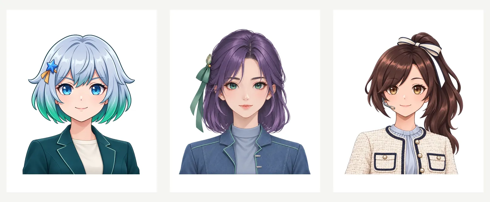

# 漫画角色：小界、小萌与小南

在小界、小萌和小南出场的漫画中使用本角色表。默认角色仍为小界与小南；小萌按场景需要加入，不要求角色始终同框。本角色表和参考图随 joyally-imagegen 分发，所有路径均相对于本文件或角色清单。

## 身份基准

先读 [characters.json](../assets/comic-characters/characters.json)，再查看其中对应角色的参考图。该清单维护版本、外观、配色、参考图路径及校验值；文字速记不代替参考图。清单中的图片路径相对于清单本身。

| 角色 | 稳定辨识特征 | 参考图 |
| --- | --- | --- |
| 小界 · xiaojie，v2 | 银蓝短波波头、青绿发梢、蓝瞳、蓝色星形发夹；深湖青现代短西装、米白内搭 | [肖像](../assets/comic-characters/xiaojie-portrait.webp)、[全身](../assets/comic-characters/xiaojie-fullbody.webp)、[头像](../assets/comic-characters/xiaojie-avatar.webp) |
| 小萌 · xiaomeng，v2 | 烟灰紫及肩短发、青绿眼睛、玉色花饰与墨绿丝带；牛仔蓝短外套 | [肖像](../assets/comic-characters/xiaomeng-portrait.webp)、[全身](../assets/comic-characters/xiaomeng-fullbody.webp)、[头像](../assets/comic-characters/xiaomeng-avatar.webp) |
| 小南 · xiaonan，v4 | 可可棕侧高马尾、米白蝴蝶结、琥珀棕眼与单侧耳麦；米白粗花呢短外套、藏蓝长裤 | [肖像](../assets/comic-characters/xiaonan-portrait.webp)、[全身](../assets/comic-characters/xiaonan-fullbody.webp)、[头像](../assets/comic-characters/xiaonan-avatar.webp) |

## 场景中的角色使用

小界可提出任务、追问机制、核对结果；小萌可说明反馈与自进化；小南可演示动作、观察变化、协助解释。根据文章需要调整对话分工，真实软件组件的职责仍以事实来源为准。

使用 joyally-imagegen 生成场景。参考图锁定脸型、发型、瞳色、衣饰和绘画语言；每格重新生成所需动作、表情、视角和环境，不反复粘贴相同头像。保持三人的发型轮廓、瞳色和服装大色块可区分。

仅修复既有图中的一个角色时，保护其他已批准区域。新场景允许角色重新表演；“形象不变”指保持当前参考图中的身份与造型，不要求将原头像像素粘到新画面。逐格核对说话人、动作、手部、关键道具和技术文字。

## 维护

更新角色时同步修改清单中的版本、外观、图片路径、尺寸和 SHA-256，复核本表及形象对照图，再检查受影响的当前漫画和封面。历史证据保持原样。只分发角色人设与参考艺术，不加入私有项目配置、内部地址、账号、原始生成记录或凭证。
